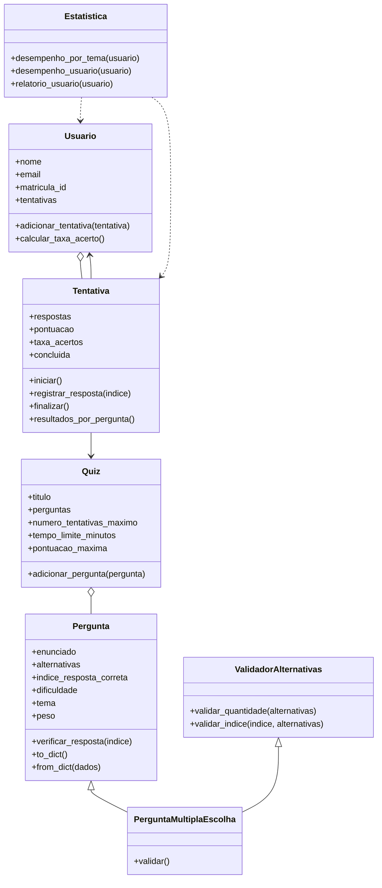

# Sistema de Quiz Educacional

Projeto 1 de Programação Orientada a Objetos (UFCA) — Tema 7.

## 1. Descrição do projeto

O Sistema de Quiz Educacional é uma aplicação orientada a objetos, escrita em Python, para criação, gerenciamento e execução de quizzes com perguntas de múltipla escolha.

O sistema permite cadastrar perguntas, montar quizzes, registrar as tentativas realizadas pelos usuários e acompanhar o desempenho obtido. Os dados são persistidos em arquivos JSON, sem uso de frameworks ORM. A interface de linha de comando (CLI) está prevista para as próximas etapas.

## 2. Objetivo

Desenvolver um sistema educacional simples que organize quizzes, registre as respostas dos usuários e permita acompanhar o desempenho obtido nas diferentes avaliações.

## 3. Funcionalidades

### Já implementadas

- Cadastro e validação de perguntas de múltipla escolha (3 a 5 alternativas, índice da resposta correta válido, dificuldade e tema).
- Bloqueio de perguntas duplicadas (mesmo enunciado e mesmo tema) dentro de um quiz.
- Montagem de quizzes com perguntas de um ou mais temas.
- Cálculo automático da pontuação máxima do quiz, pela soma dos pesos das perguntas (fácil = 1, médio = 2, difícil = 3).
- Cadastro de usuários e associação das tentativas realizadas.
- Execução de uma tentativa: iniciar, registrar respostas, finalizar, com pontuação ponderada, taxa de acertos, data/hora e tempo total.
- Persistência em JSON de perguntas, quizzes, usuários e tentativas.
- Relatório de desempenho do usuário (taxa de acerto geral e por tema).

### Planejadas para as próximas etapas

- Controle do limite de tentativas por usuário e do tempo limite do quiz.
- Leitura de pesos e limites a partir de um `settings.json`.
- Interface de linha de comando (CLI) com subcomandos.
- Relatórios consolidados: ranking de usuários, questões mais erradas e evolução do desempenho.

## 4. Estrutura do projeto

```
projeto1_quiz_educacional/
├── src/
│   ├── __init__.py
│   ├── pergunta.py                  # classe base Pergunta
│   ├── validador.py                 # mixin ValidadorAlternativas
│   ├── pergunta_multipla_escolha.py # herança múltipla
│   ├── quiz.py                      # Quiz (agrega Perguntas)
│   ├── usuario.py                   # Usuario (possui Tentativas)
│   ├── tentativa.py                 # Tentativa (execução de um quiz)
│   ├── estatistica.py               # relatórios
│   └── dados.py                     # persistência em JSON
├── tests/                           # testes automatizados (pytest)
├── dados/                           # arquivos JSON (criada ao salvar)
├── main.py                          # pequena demonstração
├── pytest.ini
├── README.md
└── UML.md
```

## 5. Classes

### Pergunta
Classe base do domínio. Guarda enunciado, alternativas, índice da resposta correta, dificuldade e tema. Todos os campos são validados por `@property`. Informa o próprio peso (`peso`, conforme a dificuldade) e confere respostas (`verificar_resposta`).

### ValidadorAlternativas
Mixin com as regras de validação das alternativas (quantidade entre 3 e 5 e índice existente). Não é usado sozinho: serve para ser herdado.

### PerguntaMultiplaEscolha
Herda de `Pergunta` e de `ValidadorAlternativas` (herança múltipla). Acrescenta o método `validar()` e um `__str__` que identifica o tipo da pergunta.

### Quiz
Mantém título, lista de perguntas, número máximo de tentativas, tempo limite opcional e a pontuação máxima, calculada automaticamente. Implementa `__len__`, `__iter__` e `__str__`.

### Usuario
Representa o participante: nome, e-mail, matrícula/ID e a lista de tentativas. Calcula a taxa de acerto considerando apenas tentativas concluídas.

### Tentativa
Representa uma execução de um quiz por um usuário. Funciona como uma pequena máquina de estados (criada → iniciada → concluída) e valida cada passo.

### Estatistica
Gera os relatórios. Nesta etapa: desempenho do usuário, geral e por tema, também em formato de texto.

## 6. Diagrama de classes



## 7. Relacionamentos principais

- `Quiz` agrega várias `Pergunta`/`PerguntaMultiplaEscolha`.
- `Usuario` possui uma lista de `Tentativa`.
- `Tentativa` referencia um `Usuario` e um `Quiz`.
- `PerguntaMultiplaEscolha` herda de `Pergunta` e de `ValidadorAlternativas`.
- `Estatistica` utiliza usuários e suas tentativas para produzir relatórios.

## 8. Persistência

O módulo `dados.py` concentra as funções de salvar e carregar, uma dupla para cada tipo de dado: `salvar_perguntas`/`carregar_perguntas`, `salvar_quizzes`/`carregar_quizzes`, `salvar_usuarios`/`carregar_usuarios` e `salvar_tentativas`/`carregar_tentativas`.

Os dados ficam em quatro arquivos JSON dentro da pasta `dados/`, criada automaticamente no primeiro salvamento. Cada classe converte seus objetos em dicionários (`to_dict`) e os reconstrói (`from_dict`), e o `dados.py` apenas lê e grava esses dicionários.

A ordem de carregamento importa, porque cada etapa depende da anterior: perguntas → quizzes → usuários → tentativas.

## 9. Métodos especiais

- `__str__`: resumo de perguntas, quizzes, usuários e tentativas.
- `__len__`: quantidade de perguntas de um quiz.
- `__eq__`: comparação de perguntas por enunciado e tema.
- `__hash__`: coerente com `__eq__`, permite usar perguntas em conjuntos e dicionários.
- `__iter__`: iteração sobre as perguntas de um quiz.

## 10. Decisões de projeto

- **Herança múltipla com mixin.** `ValidadorAlternativas` concentra as regras de validação das alternativas e é combinado com `Pergunta` em `PerguntaMultiplaEscolha`. Assim, os dados da pergunta ficam separados das regras auxiliares.
- **Persistência por referências.** Um quiz guarda apenas o enunciado e o tema de suas perguntas; uma tentativa guarda apenas o ID do usuário e o título do quiz. Isso evita referências circulares (`Usuario` ↔ `Tentativa`) e repetição de dados. Ao carregar, as relações são reconstruídas e os mesmos objetos `Pergunta` são compartilhados entre o banco de perguntas e os quizzes.
- **Consistência da relação `Usuario` ↔ `Tentativa`.** `Usuario.adicionar_tentativa` só aceita tentativas que apontem de volta para o próprio usuário e recusa duplicatas.
- **Taxa de acerto contada por pergunta.** A taxa geral é o total de acertos dividido pelo total de perguntas das tentativas concluídas, e não a média das taxas de cada tentativa. Assim, a taxa geral e a taxa por tema sempre concordam, mesmo com quizzes de tamanhos diferentes.
- **Tentativas incompletas são ignoradas** nas estatísticas, conforme a regra de negócio.
- **Pontuação ponderada.** Os pesos por dificuldade (1, 2 e 3) estão definidos em `Pergunta.PESOS_POR_DIFICULDADE` e passarão a ser lidos de um `settings.json` em etapa posterior.
- **Relatório básico.** O cronograma cita "alunos por turma", que não se aplica a este tema. Foi implementado no lugar o relatório de desempenho do usuário (taxa de acerto geral e por tema), que consta nos requisitos funcionais.
- **Erros explícitos.** `TypeError` para tipo errado, `ValueError` para valor inválido e `RuntimeError` para operação fora do estado correto (por exemplo, responder antes de iniciar a tentativa).

### Limitações conhecidas

- O título do quiz é usado como identificador ao reconectar tentativas salvas, portanto deve ser único.
- O tempo de uma tentativa só é gravado ao finalizá-la; uma tentativa em andamento recarregada reinicia o cronômetro interno.

## 11. Como executar

Requisitos: Python 3.10 ou superior.

```bash
# criar e ativar um ambiente virtual (Linux/macOS)
python3 -m venv .venv
source .venv/bin/activate

# instalar a dependência de testes
pip install pytest

# rodar os testes
python -m pytest

# rodar a demonstração
python main.py
```

## 12. Exemplo de uso

```python
from src.pergunta_multipla_escolha import PerguntaMultiplaEscolha
from src.quiz import Quiz
from src.tentativa import Tentativa
from src.usuario import Usuario
from src.estatistica import Estatistica

pergunta = PerguntaMultiplaEscolha(
    "Quanto é 2 + 2?", ["3", "4", "5"], 1, "FÁCIL", "Matemática"
)
quiz = Quiz("Quiz de Matemática", [pergunta])
ana = Usuario("Ana", "ana@exemplo.com", "2024001")

tentativa = Tentativa(ana, quiz)
tentativa.iniciar()
tentativa.registrar_resposta(1)
tentativa.finalizar()
ana.adicionar_tentativa(tentativa)

print(Estatistica.relatorio_usuario(ana))
```

Saída:

```
Relatório de desempenho - Ana (2024001)
Tentativas concluídas: 1
Taxa de acerto geral: 100.0%
Por tema:
  - Matemática: 1/1 (100.0%)
```

## 13. Testes

Os testes automatizados (pytest) ficam na pasta `tests/` e cobrem criação e validação de perguntas, herança múltipla, quizzes, tentativas (fluxo e erros), usuários, persistência em JSON (incluindo arquivos inconsistentes) e relatórios.

## 14. Estado atual

Esta versão corresponde à **terceira etapa** do Projeto 1 (herança, relacionamentos e persistência básica). Estão implementadas as classes do domínio, as relações entre elas, a persistência em JSON e o relatório de desempenho do usuário.

As próximas etapas tratam do controle de tentativas e tempo limite, da pontuação lida de configurações, da interface de linha de comando e dos relatórios consolidados (ranking, questões mais erradas e evolução do desempenho).
